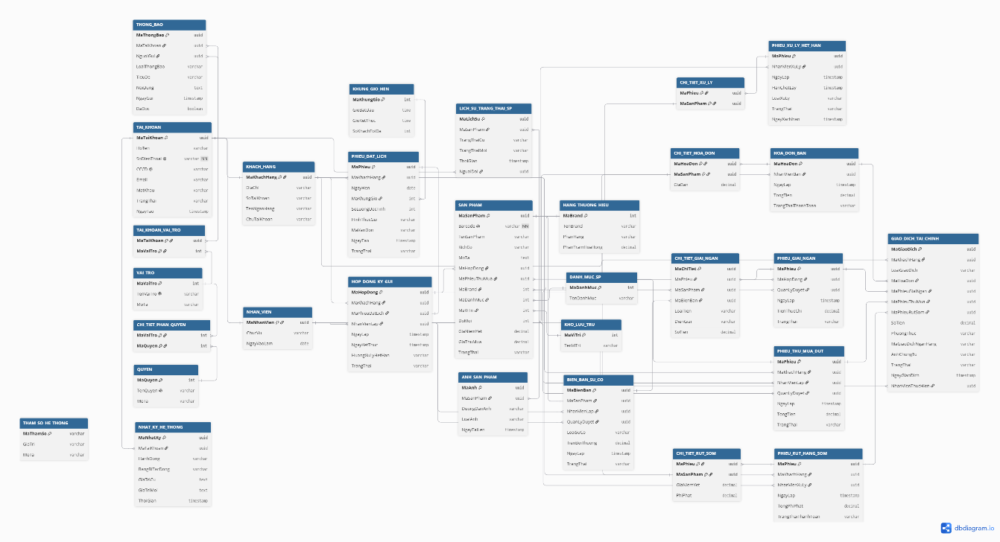

# Mô hình dữ liệu

Tài liệu này tách rõ hai lớp thông tin để không làm sai lệch hiện trạng của dự án:

- **Thiết kế báo cáo:** 30 bảng được đề xuất trong Báo cáo SE100 (Final 3).
- **Hiện thực backend:** 18 bảng đã có trong `AppDbContext`, cấu hình EF Core và migration tại thời điểm chuyển đổi tài liệu.

`DatabaseScript.txt` chỉ phản ánh lớp hiện thực backend. Các bảng còn lại trong báo cáo chưa có migration, vì vậy không được đưa vào SQL thực thi.

## Sơ đồ cơ sở dữ liệu

*Hình 1. Sơ đồ dữ liệu trong báo cáo. Sơ đồ là thiết kế nghiệp vụ, không phải ảnh chụp migration hiện hành.*

## Danh sách bảng theo báo cáo

| Nhóm | Bảng | Mục đích |
| --- | --- | --- |
| Tài khoản và phân quyền | `TAIKHOAN`, `TAIKHOAN_VAITRO`, `VAITRO`, `PHANQUYEN`, `QUYEN`, `KHACHHANG`, `NHANVIEN` | Tài khoản, hồ sơ và RBAC. |
| Đặt lịch và ký gửi | `DATLICH`, `HOPDONGKYGUI`, `KHUNGGIOHEN` | Lịch hẹn, hợp đồng và khung tiếp nhận. |
| Sản phẩm | `SANPHAM`, `LICHSUTRANGTHAISP`, `ANH_SANPHAM`, `THUONGHIEU`, `DANHMUC`, `KHOLUU` | Danh mục, sản phẩm, ảnh, vị trí và vòng đời. |
| Xử lý sản phẩm | `SUCO`, `XULYHETHAN`, `CT_XULY` | Sự cố, hàng hết hạn và chi tiết xử lý. |
| Tài chính | `HOADON`, `CT_HOADON`, `GIAINGAN`, `CT_GIAINGAN`, `THUMUA`, `RUTHANGSOM`, `CT_RUTHANG`, `GIAODICHTAICHINH` | Bán hàng, giải ngân, thu mua, rút sớm và sổ giao dịch. |
| Hệ thống | `NHATKYHETHONG`, `THONGBAO`, `THAMSO` | Audit log, thông báo và tham số vận hành. |

## Hiện trạng migration

| Trạng thái | Bảng |
| --- | --- |
| Đã có migration | `TAIKHOAN`, `TAIKHOAN_VAITRO`, `VAITRO`, `PHANQUYEN`, `QUYEN`, `KHACHHANG`, `NHANVIEN`, `NHATKYHETHONG`, `DATLICH`, `HOPDONGKYGUI`, `KHUNGGIOHEN`, `SANPHAM`, `LICHSUTRANGTHAISP`, `ANH_SANPHAM`, `THUONGHIEU`, `DANHMUC`, `KHOLUU`, `THUMUA`. |
| Chưa có migration | `SUCO`, `XULYHETHAN`, `CT_XULY`, `HOADON`, `CT_HOADON`, `GIAINGAN`, `CT_GIAINGAN`, `RUTHANGSOM`, `CT_RUTHANG`, `GIAODICHTAICHINH`, `THONGBAO`, `THAMSO`. |

## Quan hệ chính đã hiện thực

- `TAIKHOAN` có thể có một hồ sơ `KHACHHANG` hoặc `NHANVIEN`; hai hồ sơ dùng chung khóa `Id` với tài khoản.
- `TAIKHOAN` và `VAITRO` là quan hệ nhiều-nhiều qua `TAIKHOAN_VAITRO`; `VAITRO` và `QUYEN` là quan hệ nhiều-nhiều qua `PHANQUYEN`.
- `DATLICH` thuộc một `KHACHHANG` và một `KHUNGGIOHEN`. `HOPDONGKYGUI` liên kết khách hàng, lịch hẹn tùy chọn và nhân viên lập.
- `SANPHAM` thuộc một `THUONGHIEU`, `DANHMUC`; tùy chọn ở `KHOLUU`; có nguồn từ **ký gửi** hoặc **thu mua đứt**, không đồng thời cả hai.
- Một `SANPHAM` có nhiều `ANH_SANPHAM` và `LICHSUTRANGTHAISP`.
- Mọi quan hệ khóa ngoại trong migration hiện tại dùng hành vi xóa `Restrict`.

## Từ điển dữ liệu đã hiện thực

Các cột `CreatedAt` và `UpdatedAt` xuất hiện ở entity kế thừa `BaseEntity`; thời gian dùng `timestamp with time zone`.

### Tài khoản, hồ sơ và phân quyền

#### `TAIKHOAN`

| Cột | Kiểu PostgreSQL | Ràng buộc/ý nghĩa |
| --- | --- | --- |
| `Id` | `uuid` | Khóa chính, do ứng dụng sinh. |
| `AccountType` | `varchar(20)` | Bắt buộc: `Customer` hoặc `Internal`. |
| `FullName` | `varchar(200)` | Bắt buộc. |
| `PhoneNumber` | `varchar(20)` | Bắt buộc; duy nhất theo cặp loại tài khoản và số điện thoại. |
| `Username` | `varchar(100)` | Duy nhất khi có giá trị; bắt buộc với tài khoản nội bộ. |
| `Email` | `varchar(254)` | Duy nhất theo cặp loại tài khoản và email khi có giá trị. |
| `IdentityNumber` | `varchar(20)` | Duy nhất theo cặp loại tài khoản và CCCD khi có giá trị. |
| `PasswordHash` | `varchar(512)` | Bắt buộc với tài khoản nội bộ đang `Active`. |
| `Status` | `varchar(30)` | `PendingActivation`, `Active`, `Locked`, `Deactivated`. |
| `PhoneVerifiedAt`, `ActivatedAt` | `timestamptz` | Có thể rỗng. |
| `CreatedByAccountId` | `uuid` | FK tự tham chiếu tới `TAIKHOAN`, có thể rỗng. |
| `CreatedAt`, `UpdatedAt` | `timestamptz` | Thời điểm tạo/cập nhật. |

| Bảng | Cột chính | Ý nghĩa |
| --- | --- | --- |
| `KHACHHANG` | `Id` (PK/FK `TAIKHOAN`), `Address`, `BankCode`, `BankAccountNumber`, `BankAccountHolderName`, `Status` | Hồ sơ người ký gửi; `Status`: `Active` hoặc `Suspended`. |
| `NHANVIEN` | `Id` (PK/FK `TAIKHOAN`), `JobTitle`, `HiredOn`, `Status` | Hồ sơ nhân viên; `Status`: `Working`, `Suspended`, `Left`. |
| `VAITRO` | `Id`, `Code` (unique), `Name`, `Description` | Danh mục vai trò. |
| `QUYEN` | `Id`, `Code` (unique), `Name`, `Description` | Danh mục quyền. |
| `TAIKHOAN_VAITRO` | `AccountId`, `RoleId` | PK ghép và FK tới tài khoản/vai trò. |
| `PHANQUYEN` | `RoleId`, `PermissionId` | PK ghép và FK tới vai trò/quyền. |

#### `NHATKYHETHONG`

| Cột | Kiểu PostgreSQL | Ý nghĩa |
| --- | --- | --- |
| `Id` | `uuid` | Khóa chính. |
| `ActorAccountId` | `uuid` | FK tới `TAIKHOAN`, có thể rỗng cho tác nhân hệ thống/ẩn danh. |
| `ActorType` | `varchar(20)` | `User`, `System`, `Anonymous`; `User` bắt buộc có `ActorAccountId`. |
| `Action`, `EntityType`, `EntityId` | `varchar(100/100/200)` | Hành động, loại và định danh bản ghi bị tác động. |
| `Changes` | `jsonb` | Giá trị cũ/mới hoặc dữ liệu thay đổi. |
| `Reason` | `varchar(1000)` | Lý do, có thể rỗng. |
| `OccurredAt`, `RecordedAt` | `timestamptz` | Thời điểm xảy ra và ghi nhận. |
| `Source`, `IpAddress`, `CorrelationId` | `varchar(50/45/128)` | Nguồn, IP và mã tương quan, các cột sau có thể rỗng. |

### Danh mục và lịch hẹn

| Bảng | Cột chính | Ràng buộc đáng chú ý |
| --- | --- | --- |
| `THUONGHIEU` | `Id`, `Name`, `Tier`, `DefaultCommissionRate`, `IsActive`, thời điểm tạo/cập nhật | `Name` duy nhất; `Tier`: `NoBrand`, `LocalBrand`, `Commercial`, `Luxury`; hoa hồng từ 0 đến 100. |
| `DANHMUC` | `Id`, `Name`, `IsActive`, thời điểm tạo/cập nhật | `Name` duy nhất. |
| `KHOLUU` | `Id`, `Code`, `Name`, `IsActive`, thời điểm tạo/cập nhật | `Code` duy nhất. |
| `KHUNGGIOHEN` | `Id`, `StartTime`, `EndTime`, `MaxCustomers`, `IsActive`, thời điểm tạo/cập nhật | Cặp giờ bắt đầu/kết thúc duy nhất; `EndTime > StartTime`; `MaxCustomers > 0`. |
| `DATLICH` | `Id`, `CustomerId`, `TimeSlotId`, `AppointmentDate`, `EstimatedItemCount`, `SubmissionMethod`, `TrackingNumber`, `Status`, thời điểm tạo/cập nhật | FK tới `KHACHHANG` và `KHUNGGIOHEN`; số lượng không âm; `SubmissionMethod`: `InPerson`/`Shipping`; `Status`: `Scheduled`/`Cancelled`/`Completed`. |

### Hợp đồng, thu mua và sản phẩm

#### `HOPDONGKYGUI`

| Cột | Kiểu PostgreSQL | Ràng buộc/ý nghĩa |
| --- | --- | --- |
| `Id` | `uuid` | Khóa chính. |
| `ContractNumber` | `varchar(50)` | Bắt buộc, duy nhất. |
| `CustomerId` | `uuid` | FK `KHACHHANG`, bắt buộc. |
| `AppointmentId` | `uuid` | FK `DATLICH`, có thể rỗng. |
| `CreatedByEmployeeId` | `uuid` | FK `NHANVIEN`, bắt buộc. |
| `SignedAt`, `EndsAt` | `timestamptz` | `EndsAt` phải lớn hơn `SignedAt`. |
| `ExpiryHandling` | `varchar(20)` | `Return` hoặc `Donate`. |
| `Status` | `varchar(20)` | `Active` hoặc `Completed`. |
| `CreatedAt`, `UpdatedAt` | `timestamptz` | Thời điểm tạo/cập nhật. |

#### `THUMUA`

| Cột | Kiểu PostgreSQL | Ràng buộc/ý nghĩa |
| --- | --- | --- |
| `Id` | `uuid` | Khóa chính. |
| `BuyoutNumber` | `varchar(50)` | Bắt buộc, duy nhất. |
| `CustomerId`, `CreatedByEmployeeId` | `uuid` | FK bắt buộc tới khách hàng và nhân viên lập. |
| `ApprovedByEmployeeId` | `uuid` | FK nhân viên duyệt, có thể rỗng nhưng bắt buộc khi `Status = Approved`. |
| `TotalPurchasePrice` | `numeric(18,2)` | Không âm. |
| `Status` | `varchar(20)` | `Pending`, `Approved`, `Rejected`. |
| `CreatedAt`, `UpdatedAt` | `timestamptz` | Thời điểm tạo/cập nhật. |

#### `SANPHAM`

| Cột | Kiểu PostgreSQL | Ràng buộc/ý nghĩa |
| --- | --- | --- |
| `Id` | `uuid` | Khóa chính. |
| `Barcode` | `varchar(100)` | Bắt buộc, duy nhất. |
| `Name`, `Size`, `Description` | `varchar(200/30/2000)` | Tên và size bắt buộc; mô tả có thể rỗng. |
| `ConditionPercentage` | `integer` | Từ 0 đến 100. |
| `BrandId`, `CategoryId`, `StorageLocationId` | `uuid` | FK thương hiệu/danh mục bắt buộc; vị trí lưu có thể rỗng. |
| `SourceType` | `varchar(20)` | `Consignment` hoặc `Buyout`. |
| `ConsignmentContractId`, `BuyoutId` | `uuid` | Chỉ một FK được có giá trị, phù hợp với `SourceType`. |
| `ListedPrice`, `PurchasePrice` | `numeric(18,2)` | Giá niêm yết không âm; giá mua có thể rỗng nhưng nếu có phải không âm. |
| `AgreedCommissionRate` | `numeric(5,2)` | Chỉ dùng với ký gửi, từ 0 đến 100. |
| `AgreedBrandTier` | `varchar(30)` | Chỉ dùng với ký gửi: `NoBrand`, `LocalBrand`, `Commercial`, `Luxury`. |
| `Status` | `varchar(30)` | `PendingProcessing`, `OnSale`, `Sold`, `Expired`, `Donated`, `Returned`, `EarlyWithdrawn`, `Compensated`, `Cancelled`. |
| `CreatedAt`, `UpdatedAt` | `timestamptz` | Thời điểm tạo/cập nhật. |

| Bảng | Cột chính | Ràng buộc đáng chú ý |
| --- | --- | --- |
| `ANH_SANPHAM` | `Id`, `ProductId`, `Url`, `ImageType`, `SortOrder`, thời điểm tạo/cập nhật | `Url` không rỗng; `ImageType`: `Cover`, `Detail`, `Incident`; `SortOrder >= 0`; mỗi sản phẩm chỉ có một ảnh `Cover`. |
| `LICHSUTRANGTHAISP` | `Id`, `ProductId`, `PreviousStatus`, `NewStatus`, `OccurredAt`, `ChangedByAccountId`, `Reason` | Không cho phép trạng thái cũ và mới trùng nhau; trạng thái phải thuộc tập trạng thái của sản phẩm. |

## Bảng được thiết kế trong báo cáo nhưng chưa có migration

Phần này giữ lại từ điển dữ liệu của báo cáo để dùng khi hiện thực các phân hệ còn thiếu. Tên cột được giữ theo thiết kế Word; chưa nên chạy trực tiếp như SQL.

### Xử lý sản phẩm

| Bảng | Thuộc tính theo báo cáo |
| --- | --- |
| `SUCO` | `MaSuCo` (PK), `MaSanPham` (FK), `NhanVienLap` (FK), `QuanLyDuyet` (FK), `LoaiSuCo`, `TienBoiThuong` (> 0), `NgayLap`, `TrangThai` (`Pending`, `Approved`, `Compensated`). |
| `XULYHETHAN` | `MaXuLy` (PK), `NhanVienXuLy` (FK), `NgayLap`, `HanChotLay` (không trước ngày lập), `LoaiXuLy` (`Donate`, `Return`), `TrangThaiXuLy` (`Pending`, `Completed`, `Overdue`), `NgayXacNhan`. |
| `CT_XULY` | PK ghép `MaXuLy` (FK `XULYHETHAN`) và `MaSanPham` (FK `SANPHAM`). |

### Tài chính

| Bảng | Thuộc tính theo báo cáo |
| --- | --- |
| `HOADON` | `MaHoaDon` (PK), `NhanVienBan` (FK), `NgayLap`, `TongTien` (không âm), `TrangThaiThanhToan` (`Unpaid`, `Partial`, `Paid`). |
| `CT_HOADON` | PK ghép `MaHoaDon` (FK `HOADON`) và `MaSanPham` (FK `SANPHAM`), `GiaBan` (không âm). |
| `GIAINGAN` | `MaGiaiNgan` (PK), `MaHopDong` (FK), `QuanLyDuyet` (FK), `NgayLap`, `TienThucChi` (không âm), `TrangThaiGiaiNgan` (`Pending`, `Transferred`, `Completed`). |
| `CT_GIAINGAN` | `MaCTGN` (PK), `MaGiaiNgan` (FK), `MaSanPham` (FK), `MaSuCo` (FK), `LoaiTien` (`HoaHong`, `BoiThuong`, `PhiDichVu`), `DienGiai`, `SoTien`. |
| `RUTHANGSOM` | `MaRutHang` (PK), `MaKhachHang` (FK), `NhanVienXuLy` (FK), `NgayLap`, `TongPhiPhat` (không âm), `TrangThaiThanhToan` (`Unpaid`, `Partial`, `Paid`). |
| `CT_RUTHANG` | PK ghép `MaRutHang` (FK) và `MaSanPham` (FK), `GiaNiemYet` (không âm), `PhiRutSom` (từ 0 đến giá niêm yết). |
| `GIAODICHTAICHINH` | `MaGiaoDich` (PK), `MaKhachHang` (FK, có thể rỗng), `LoaiGiaoDich` (`Income`, `Expense`, `Transfer`), tham chiếu hóa đơn/giải ngân/thu mua/rút hàng, `SoTien`, `PhuongThuc` (`Cash`, `VietQR`, `BankTransfer`), mã giao dịch ngân hàng, ảnh minh chứng, trạng thái và nhân viên thực hiện. |

### Hệ thống

| Bảng | Ghi chú theo báo cáo |
| --- | --- |
| `THONGBAO` | Bảng mô tả trong Word để trống; sơ đồ dữ liệu của báo cáo thể hiện các trường `MaThongBao`, `MaTaiKhoan`, `NguoiGui`, `LoaiThongBao`, `TieuDe`, `NoiDung`, `NgayGui`, `DaXem`. Cần chốt kiểu dữ liệu/ràng buộc trước khi tạo migration. |
| `THAMSO` | Bảng mô tả trong Word để trống; sơ đồ dữ liệu thể hiện `MaThamSo`, `GiaTri`, `MoTa`. Cần chốt kiểu dữ liệu/ràng buộc trước khi tạo migration. |

`NHATKYHETHONG` đã có migration và hiện được hiện thực chi tiết ở phần trên; thiết kế Word ban đầu chỉ liệt kê các ý: tác nhân, tài khoản, hành động, bảng/bản ghi tác động, giá trị cũ/mới, IP và thời gian.
